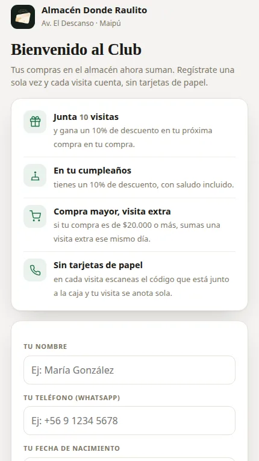

# Club de Clientes — Almacén Donde Raulito

A loyalty program PWA for a neighborhood grocery store in Maipú, Chile. It replaces paper stamp cards: customers earn visits with every purchase and redeem rewards, while the owner manages everything from a protected panel.

**Live app:** https://donderaulito.github.io/donde-raulito-almacen/



## How it works

**For customers** (`cliente.html`)
- Register once with name, WhatsApp number, and birthdate — with an explicit data-consent step (Chilean Ley 19.628).
- Each in-store visit is stamped by scanning the register's QR code. The code **rotates every ~2.5 minutes and expires in 5 minutes**, so a photo of the code can't be reused from home. An NFC card at the counter works as a tap alternative.
- 10 visits earn a 10% discount; birthdays earn 10% too; a large purchase adds an extra visit the same day. One visit per day, per customer.
- Each customer sees only their own progress, looked up by their phone number.

**For the owner** (`index.html`)
- Login-protected panel (Firebase Authentication; only authorized accounts can open it).
- Member list with search, visit counts, and pending rewards — rewards are confirmed from the panel, so the client app can never write them on its own.
- "Modo caja" (register mode) displays the rotating QR for customers to scan.
- One-tap daily notices and bulk WhatsApp campaigns with personalized templates.

## Tech

- Vanilla JavaScript, HTML, and CSS — no framework
- Firebase Authentication + Cloud Firestore, with restrictive security rules (anonymous users can read a single record by phone number, never list the database; writes follow strict per-role rules)
- Progressive Web App: installable, offline shell, service worker
- Hosted on GitHub Pages

## Run locally

```bash
git clone https://github.com/donderaulito/donde-raulito-almacen.git
cd donde-raulito-almacen
python3 -m http.server 8000
# Client card:  http://localhost:8000/cliente.html
# Owner panel:  http://localhost:8000/  (login required)
```

---

Built and maintained by [Ramiro Bugueño](https://github.com/ramiiron) — IT support specialist & systems administration student.
